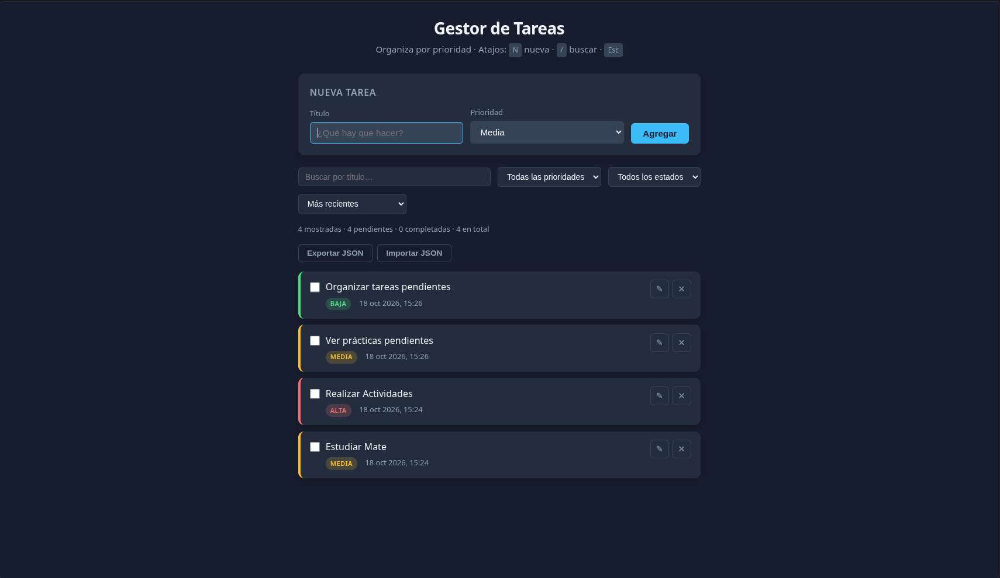

# Gestor de Tareas por Prioridad

Aplicación web de gestión de tareas con prioridades (alta, media, baja), filtros, ordenamiento y persistencia en `localStorage`.  
Implementada con **TypeScript** y arquitectura **MVC**.

<div align="center">

**Probar en vivo:** <br><br>
[](https://gestor-de-tareas-yonazakkart.netlify.app/)

</div>

___

### Pantalla principal



### Importar / exportar JSON

<video src="https://github.com/YonaZakkart/gestor-tareas/raw/main/docs/videos/01-export-import.mp4" controls="controls" width="100%"></video>

### Deshacer eliminación

<video src="https://github.com/YonaZakkart/gestor-tareas/raw/main/docs/videos/02-deshacer.mp4" controls="controls" width="100%"></video>
</video>

## Características

- Registrar tareas con título y prioridad (alta / media / baja)
- Ordenar por prioridad o por fecha
- Filtrar por prioridad y estado + búsqueda por título
- Marcar como completadas, editar inline y eliminar con confirmación
- **Exportar / importar JSON** (respaldo y restauración con validación)
- **Deshacer** la última eliminación (ventana de 5 segundos)
- **Atajos de teclado:** `N` nueva tarea · `/` buscar · `Esc` quitar foco / cerrar mensaje
- Validaciones de dominio y persistencia en `localStorage`
- Estados vacíos claros (sin tareas vs. filtro sin resultados)
- Contador: mostradas · pendientes · completadas · total
- Mensajes de éxito/error (los de éxito se ocultan solos)
- Interfaz con colores por prioridad y diseño responsive

## Arquitectura MVC

| Capa | Archivo | Responsabilidad |
|------|---------|-----------------|
| **Model** | `src/models/Tarea.ts` | Datos, validaciones e invariantes de negocio |
| **View** | `src/views/TareaView.ts` | Renderizado DOM, eventos, callbacks |
| **Controller** | `src/controllers/TareaController.ts` | CRUD, filtros, orden, import/export, undo |
| **Service** | `src/services/StorageService.ts` | Persistencia en `localStorage` (aislado) |

El punto de entrada `src/main.ts` instancia la vista y el controlador.

## Clonar e instalar

```bash
git clone https://github.com/YonaZakkart/gestor-tareas.git
cd gestor-tareas
npm install
npm run build
npx serve .
```

Abre la URL que indique el servidor (por ejemplo `http://localhost:3000`).

## Scripts

| Comando | Descripción |
|---------|-------------|
| `npm run build` | Compila TypeScript → `dist/` |
| `npm start` | Compila y sirve la app |
| `npm run dev` | Recompilación en vigilancia (`tsc --watch`) |
| `npm test` | Tests unitarios del modelo (Vitest) |
| `npm run test:watch` | Tests en modo vigilancia |

## Tests

```bash
npm test
```

Cubren validaciones del constructor, `toggleCompletada`, `actualizar` y serialización `toJSON` / `fromJSON` del modelo `Tarea`.

## Despliegue (Netlify)

Sitio en producción: [gestor-de-tareas-yonazakkart.netlify.app](https://gestor-de-tareas-yonazakkart.netlify.app/)

Configuración usada:

| Campo | Valor |
|--------|--------|
| Build command | `npm run build` |
| Publish directory | `.` (raíz del repositorio) |

Cada push a `main` dispara un deploy automático. Opcionalmente el repo incluye `netlify.toml` con la misma configuración.

## Estructura de carpetas

```
gestor-tareas/
├── index.html
├── favicon.svg
├── package.json
├── tsconfig.json
├── vitest.config.ts
├── netlify.toml
├── docs/
│   ├── capturas/
│   │   └── 01-listado.png
│   └── videos/
│       ├── 01-export-import.mp4
│       └── 02-deshacer.mp4
├── src/
│   ├── main.ts
│   ├── models/
│   │   ├── Tarea.ts
│   │   └── Tarea.test.ts
│   ├── views/
│   │   └── TareaView.ts
│   ├── controllers/
│   │   └── TareaController.ts
│   ├── services/
│   │   └── StorageService.ts
│   └── styles/
│       └── styles.css
└── README.md
```

## Decisiones de diseño

- **Validación en el modelo:** `Tarea` lanza errores si el título está vacío o la prioridad es inválida; el controlador los muestra en la vista.
- **Callbacks en la vista:** la vista no conoce al controlador; solo expone `onXxx` que el controlador registra.
- **Importación JSON:** reemplaza el listado actual tras confirmación; cada ítem se valida con `Tarea.fromJSON`.
- **Deshacer eliminación:** guarda temporalmente la tarea y el índice durante 5 segundos.
- **Persistencia:** array completo en `localStorage` (clave `gestor-tareas-v1`) en cada mutación.

## Licencia

MIT
